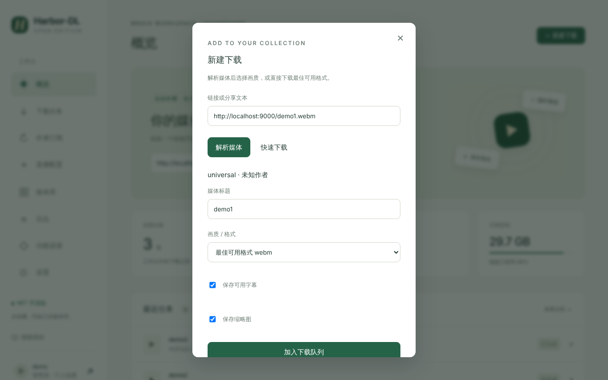

# Downloads

下载基于 yt-dlp，支持 YouTube、哔哩哔哩、抖音、小红书、快手、TikTok、Instagram、X / Twitter、网易云音乐等平台（任务页的平台筛选列出了当前识别的平台），无法识别的链接走「通用解析」。

## 新建下载

1. 点「＋ 新建下载」，或在概览页粘贴链接后点「解析链接」。链接框里可以直接粘贴**分享文本**，不用手动抠出链接。
2. 点「解析媒体」读取标题、作者、可用格式；点「快速下载」则跳过选择，直接下载最佳可用格式。
3. 需要时修改标题，选择「画质 / 格式」，勾选「保存可用字幕」「保存缩略图」。
4. 点「加入下载队列」。

## 任务队列

- 同时下载的任务数在「设置 → 下载设置」调整（1–8，默认 2）。
- 每个任务可取消、重试、删除，已完成的任务可「保存」到本机。
- 服务重启时，未完成的下载会自动重新排队（最多 3 次，之后标为失败等待手动重试）；已下载的部分会丢弃重来。
- 合并音视频轨道需要 FFmpeg。「设置 → 运行环境」会显示是否检测到。

## 代理与 Cookie

- 全局代理在「设置 → 网络代理」，解析与下载共用，支持绕过名单。
- 需要登录才能看的内容，在「设置 → 平台 Cookie」导入 Cookie；抖音可以用 [[Browser Login]] 直接登录并保存。

## 同一作品只下载一次

作品按「平台 + 作品 ID」跨订阅识别。已经下载过的作品，在别的订阅里再次出现或被手动下载时，会直接关联已有文件，不会重复下载。

## 图集

抖音等平台的图集作品（图片 + 背景音乐）会下载全部图片和音乐，在媒体库里合并成一张卡片，并支持打包 ZIP 下载。
