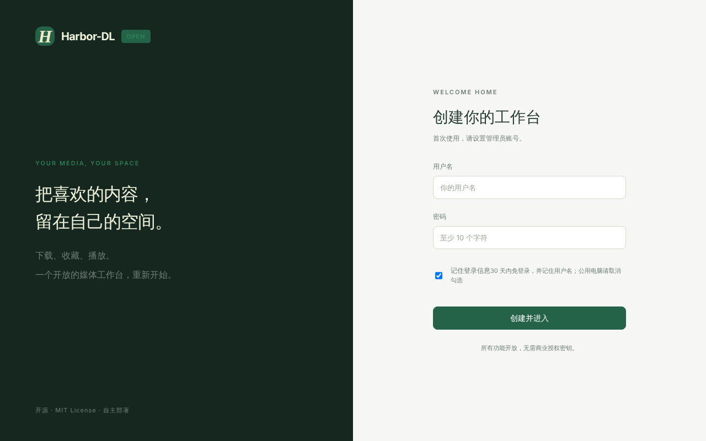

# First Steps

## 1. 创建管理员

第一次打开页面会看到「创建你的工作台」。设置用户名和密码（至少 10 个字符）。勾选「记住登录信息」后 30 天内免登录；公用电脑请取消勾选。

> 首次启动页面谁先打开谁创建管理员，所以部署后请尽快自己先注册，不要在创建管理员之前就把端口暴露出去。

## 2. 下载第一个链接

点右上角「＋ 新建下载」，或直接在「概览」页的输入框里粘贴链接，再点「解析链接」。详见 [[Downloads]]。

## 3. 在媒体库里播放

下载完成的文件会自动出现在「媒体库」。点击封面播放，或使用「沉浸播放」连续观看。详见 [[Library and Player]]。

## 4.（可选）订阅作者

进入「作者订阅」添加作者。读取抖音作品列表需要先登录抖音，见 [[Browser Login]] 和 [[Subscriptions]]。

## 5.（可选）接入 Jellyfin / Emby

在「设置 → 媒体服务器」启用导出，见 [[Media Server Export]]。

## 数据放在哪里

容器内的 `/data` 就是数据目录（本地运行时默认是 `./var`）。目录结构见 [[Deployment and Backup]]。
