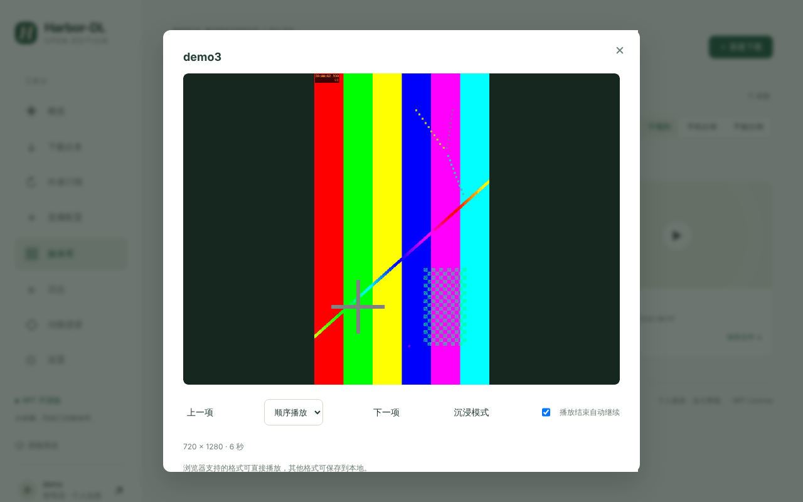
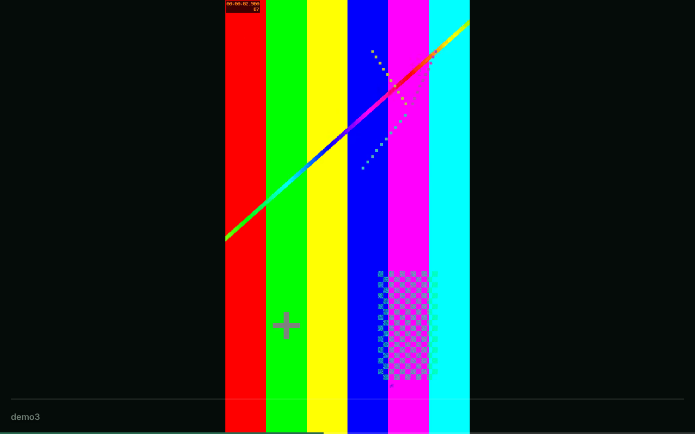

# Library and Player

## 媒体库

下载完成的文件自动入库，不需要手动整理。

- **类型筛选**：全部 / 视频 / 图集 / 图片 / 音频，标签上带数量。
- **搜索与排序**：按标题或文件名搜索；排序默认「最新收藏」。
- **封面比例**：不规则 / 手机比例 / 平板比例，三种布局随时切换。
- **合并卡片**：同一作品的图片与音乐合并为一张卡片。
- **悬停预览**：鼠标悬停时静音预览。
- **封面缓存**：平台的封面链接会过期，下载和同步时会把封面按哈希目录缓存到本地。

## 快速预览播放器

点击卡片打开。基于 Plyr，支持倍速、字幕、画中画和快捷键。底部可「上一项 / 下一项」，选择顺序 / 随机 / 单曲循环，并可勾选「播放结束自动继续」。

> 浏览器只能直接播放自己支持的格式（例如 H.264 / VP9 的 MP4、WebM）；其他格式会提示「浏览器无法播放此格式」，此时可以「保存文件」后用本地播放器打开。

## 沉浸播放

点媒体库上的「▶ 沉浸播放」，进入类抖音的全屏竖滑播放：

- 上下滑动切换作品，右侧有静音、倍速、保存、循环、下一条等按钮；
- 浏览器可能阻止带声音的自动播放，此时会先静音并提示「已静音播放，点击开启声音」；
- 底部是进度条与当前标题。

## 图集

图集作品用轮播显示图片，并播放背景音乐。

## 断点续播与分享

- 播放进度会记录，下次从上次的位置继续；
- 地址栏会记录当前播放的作品，刷新页面或把链接发给自己的其他设备，可以回到原处。

## 手机上看

可以直接用手机浏览器打开，或使用 [[Mobile App]]。
