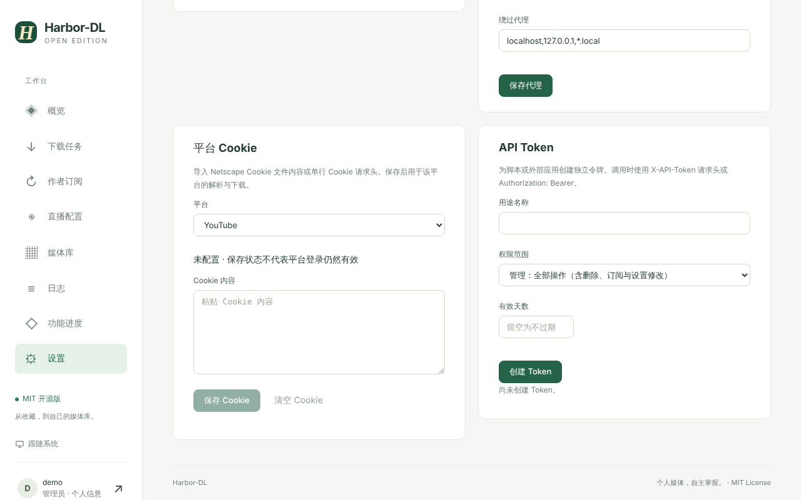

# Settings and Configuration

大部分设置在页面里完成，需要时可以用环境变量调整。

## 页面设置

「设置」页分为多个区块，改动会在重启后保留。

| 区块 | 内容 |
| --- | --- |
| 下载设置 | 同时下载的任务数（1–8，默认 2）；同时同步的订阅数（1–3，默认 1） |
| 媒体服务器 | 导出开关、媒体库目录、自动导出、删除任务时是否删除对应文件夹，见 [[Media Server Export]] |
| 运行环境 | 应用版本、FFmpeg 是否可用、许可证 |
| 网络代理 | 启用全局代理、代理地址、绕过名单（域名、前导点、`*` 通配符，逗号分隔）。解析与下载共用 |
| 平台 Cookie | 导入 Netscape Cookie 文件内容或单行 Cookie 请求头，保存后用于该平台的解析与下载 |
| API Token | 为脚本或外部应用创建独立令牌 |

## API Token

- 创建时填写用途名称和有效天数（留空为不过期），完整 Token **只在创建或重置时显示一次**，请立即保存。
- 创建时选择「权限范围」，分三档：**只读 / 下载 / 管理**（管理 = 全部操作，含删除、订阅与设置修改）。
- 调用时使用 `X-API-Token` 请求头或 `Authorization: Bearer <token>`。
- 可随时编辑名称、到期时间、启用状态，也可重新生成或删除。

## 环境变量

| 环境变量 | 作用 | 默认值 |
| --- | --- | --- |
| `HARBOR_DATA_DIR` | 数据目录 | `./var`（镜像里是 `/data`） |
| `HARBOR_FFMPEG` | FFmpeg 可执行文件路径 | 自动查找系统 `ffmpeg`，找不到时使用 `imageio-ffmpeg` 自带的 |
| `HARBOR_CHROME` | Chrome / Chromium 可执行文件路径 | 自动查找（镜像里是 `/usr/bin/chromium`） |
| `HARBOR_BROWSER_MODE` | `desktop` 弹出可见窗口；`docker` 使用虚拟显示 + noVNC | `desktop`（镜像里是 `docker`） |
| `HARBOR_DISPLAY` | Docker 模式的显示号 | `:99` |
| `HARBOR_NOVNC_DIR` / `HARBOR_VNC_WS` | noVNC 静态目录 / VNC WebSocket 地址 | 镜像内已配置 |
| `TZ` | 时区（Docker） | UTC |

## 安全提示

- Cookie 与代理凭据目前**明文**保存在本地数据库中，普通接口不会返回其内容；
- 请勿把服务直接暴露到公网；
- 容器里的 VNC 只监听容器内的 `127.0.0.1`，只能通过已登录的页面访问。
