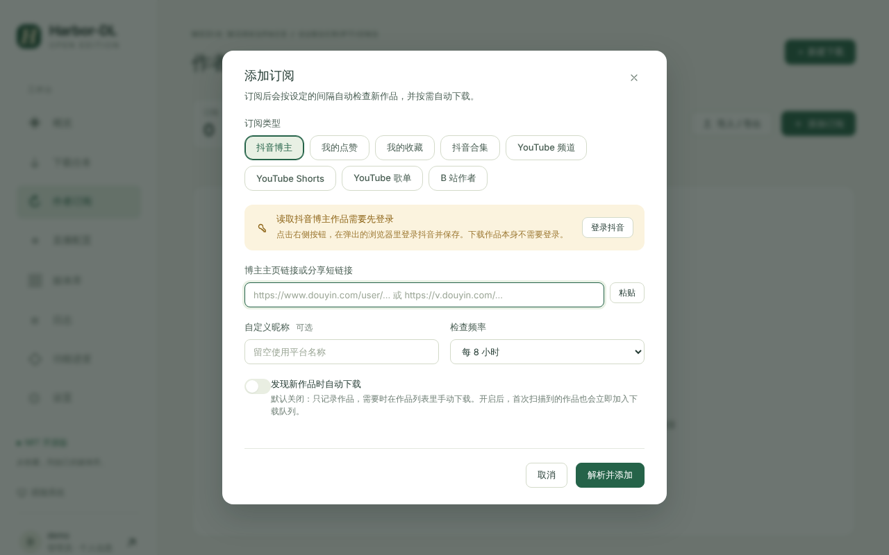

# Subscriptions

订阅会按设定的间隔自动检查作者的新作品，并按需自动下载。

## 支持的订阅类型

点「添加订阅」，先选订阅类型：

| 类型 | 说明 | 需要登录 |
| --- | --- | --- |
| 抖音博主 | 博主主页链接（`douyin.com/user/...`）或分享文本里的 `v.douyin.com` 短链接 | 读取作品列表需要 |
| 我的点赞 | **当前登录账号**点赞过的作品 | 需要 |
| 我的收藏 | **当前登录账号**收藏的作品 | 需要 |
| 抖音合集 | 合集链接、短链接或纯数字合集 ID | 需要 |
| YouTube 频道 / Shorts / 歌单 | 手动同步与单项下载 | 不需要 |
| B 站作者 | 手动同步与单项下载 | 不需要 |

> 抖音的点赞 / 收藏 / 合集接口目前只用模拟响应测试，没有真机验证；平台返回风控或格式错误时，订阅会显示失败原因。详见 [[Project Status]]。

## 添加订阅

1. 选订阅类型。抖音类会提示「读取抖音博主作品需要先登录」，点「登录抖音」按 [[Browser Login]] 登录并保存。
2. 粘贴博主主页链接或分享短链接（可点「粘贴」）。
3. 可选：自定义昵称（留空用平台昵称，填写则锁定）。
4. 选择检查频率（例如每 8 小时）。
5. 是否「发现新作品时自动下载」。默认关闭：只记录作品，需要时在作品列表里手动下载；开启后，首次扫描到的作品也会立即加入下载队列。**点赞和收藏默认不自动下载。**
6. 点「解析并添加」。

## 同步与检查

- **立即检查更新**：增量检查。没有作品记录时最多读 3 页，之后最多 5 页，读到一整页都是已知作品就停止。
- **全量同步**：读取完整历史，带进度与并发控制。
- **定时检查**：后台每 60 秒扫描一次，到期的订阅依次检查，之间随机停 3–8 秒；失败后等一个检查间隔再试。
- **需要重新登录**：登录失效时订阅页会显示这个状态，重新登录后下一次成功的检查会自动清除。
- **可能还有更多新作品**：增量检查读满页数上限仍全是新作品时的提示，全量同步成功后清除。
- 同时同步的订阅数在「设置 → 下载设置」调整（1–3，默认 1），数值越小越不容易触发风控。

## 作品列表

选中一个订阅，右侧是作品网格：

- 状态筛选与计数、标题 / ID 搜索、分页；
- 选择模式与批量下载；
- 单项下载 / 重试 / 重新下载 / 播放 / 编辑 NFO / 移除记录（只移除列表记录，文件保留）；
- 文件缺失清理；
- 订阅设置：昵称、检查频率、自动下载、画质、NFO 开关。

## 下载不需要登录

下载作品本身**不使用**已保存的登录 Cookie，只用代理；抖音用一次性的匿名无头 Chrome 取作品详情，每个作品多花数秒。

## 备份与迁移

「导入 / 导出」可以导出订阅清单，也可以从备份恢复。

## 文件归类

文件和媒体库目录按**原作者**归类：点赞 / 收藏 / 合集订阅里的作品用作品自带的作者名，不会另建「我的点赞」目录。
