# UI Tour

左侧是固定的侧边栏，右上角的「＋ 新建下载」在每个页面都能用。侧边栏底部有主题切换（浅色 / 深色 / 跟随系统）和账号入口。

## 概览

粘贴链接即可开始下载，下面是任务数、进行中、媒体文件数和可用磁盘空间，再往下是最近任务。

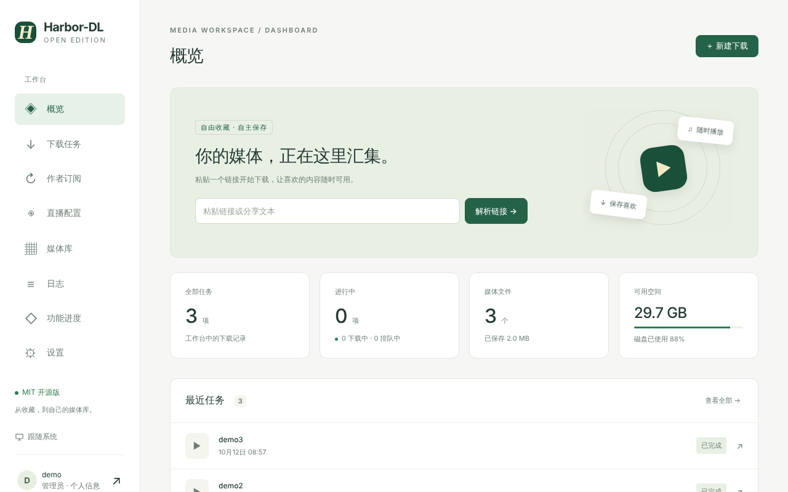

## 下载任务

按状态（全部 / 进行中 / 排队中 / 下载中 / 处理中 / 已完成 / 失败 / 已取消）、平台、「仅手动任务」「仅文件缺失」筛选，也可搜索标题、文件名或作者。每页 24 项，筛选和搜索覆盖全部任务。

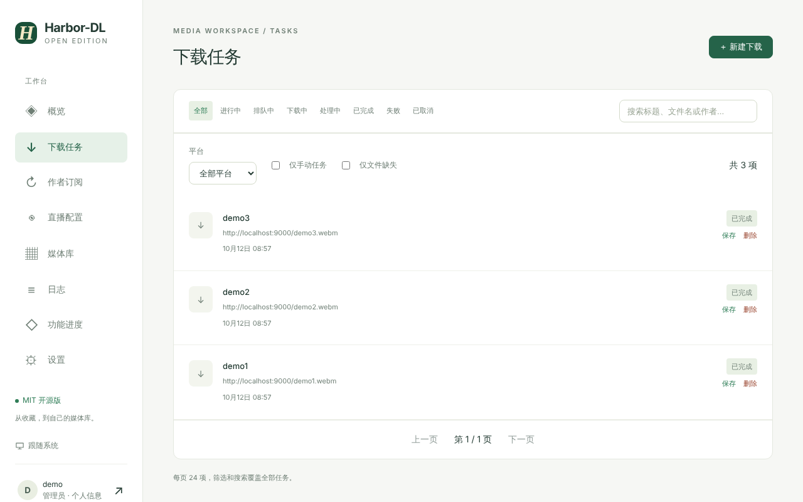

## 作者订阅

顶部是订阅数、已读取作品、自动检查中、检查失败四个计数。详见 [[Subscriptions]]。

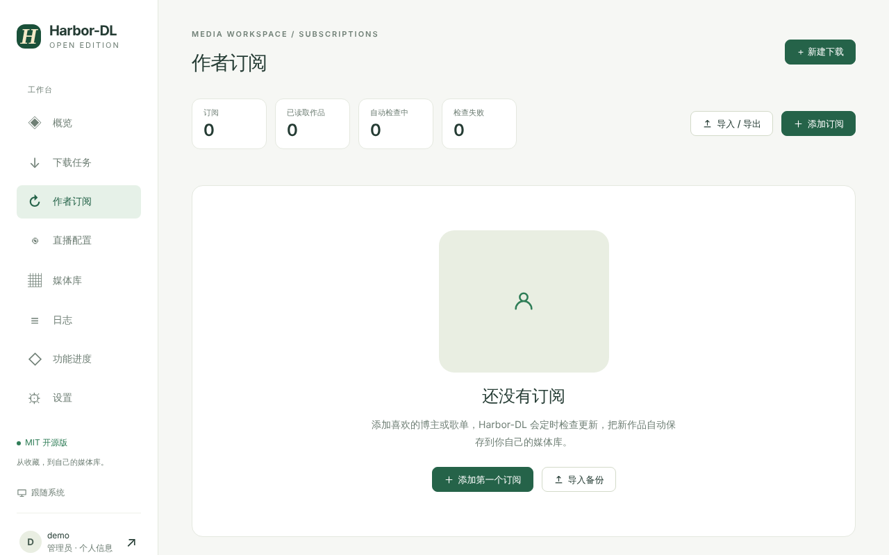

## 直播配置

导入 / 导出直播订阅备份（JSON），导入后可编辑每个直播间的配置。详见 [[Live Recording]]。

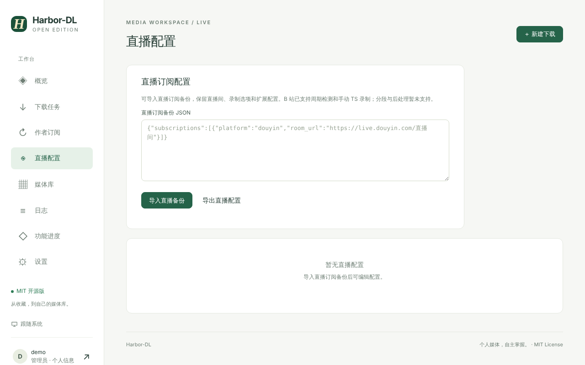

## 媒体库

下载完成的文件在这里浏览与播放。详见 [[Library and Player]]。

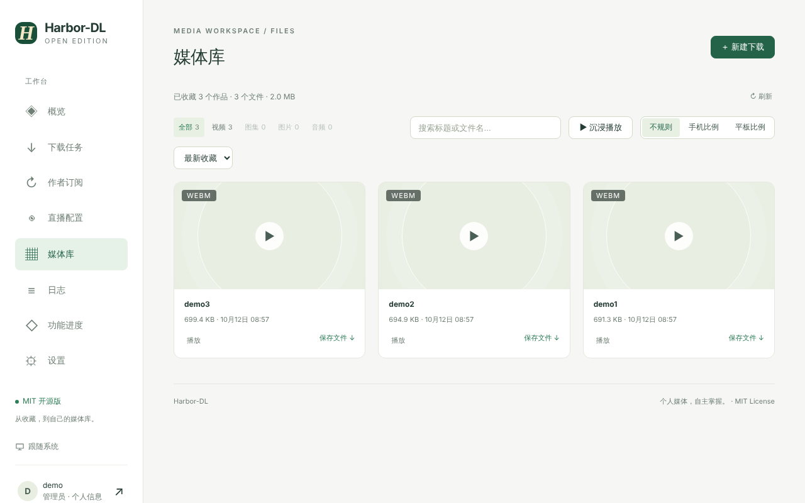

## 日志

查看下载、订阅、直播等事件日志，排查问题时先来这里。

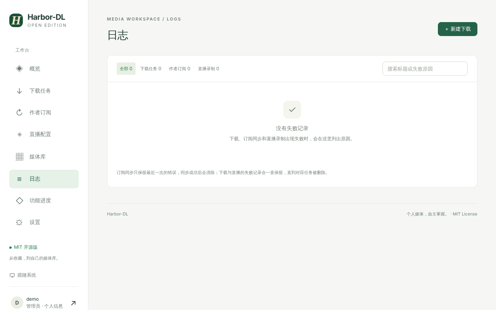

## 功能进度

页面内置的路线图，显示每个模块当前真实的实现状态。

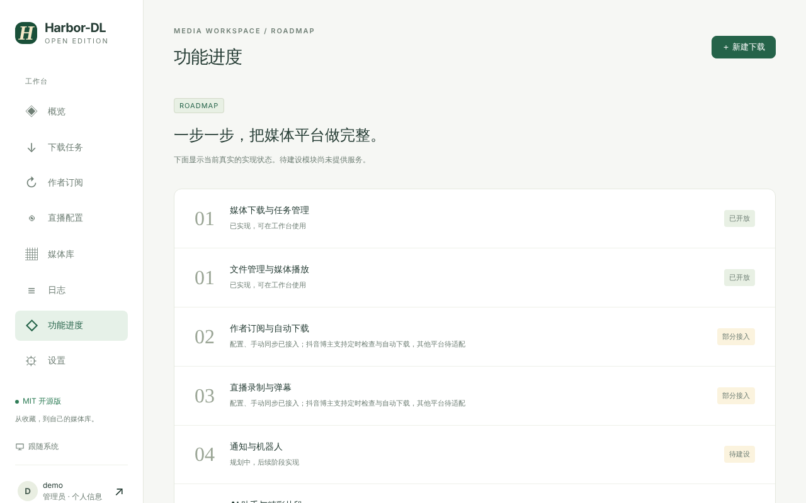

## 设置

下载并发、媒体服务器导出、运行环境、网络代理、平台 Cookie、API Token。详见 [[Settings and Configuration]]。

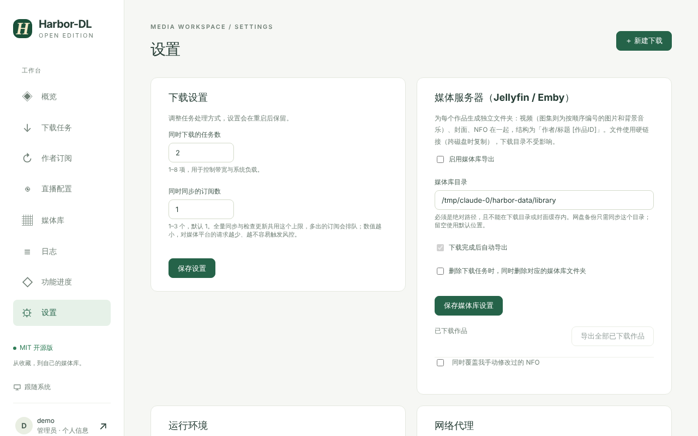

## 个人信息

修改用户名、头像等账号信息。

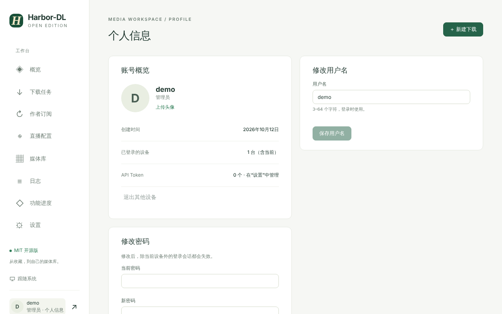

## 深色模式与手机浏览器

界面使用统一的设计令牌，深色模式下所有页面同步切换；窄屏下侧边栏会收成只有图标的窄条，内容区改为单列。

| 深色模式 | 手机宽度 |
| --- | --- |
| 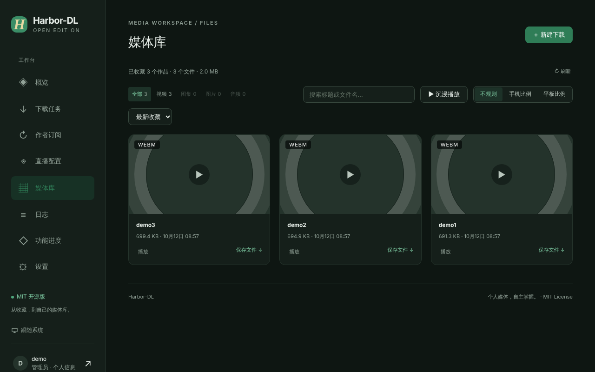 | 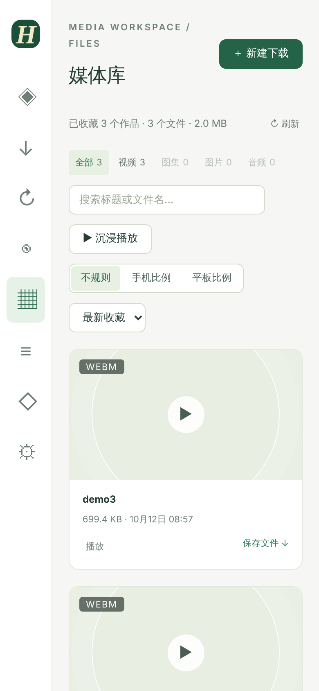 |
